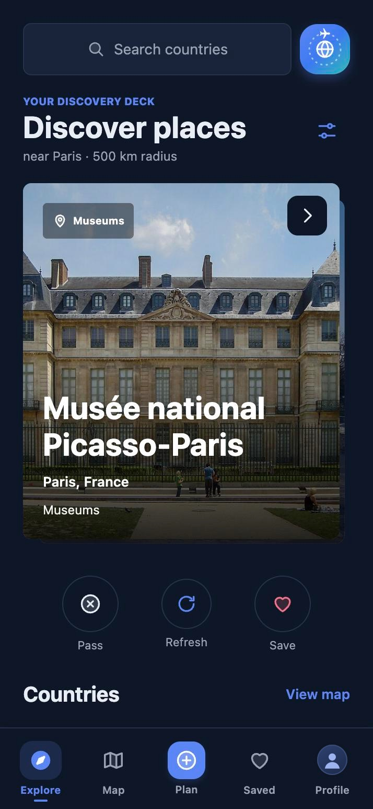
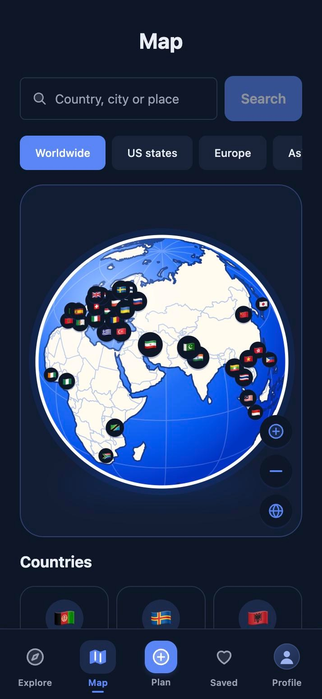
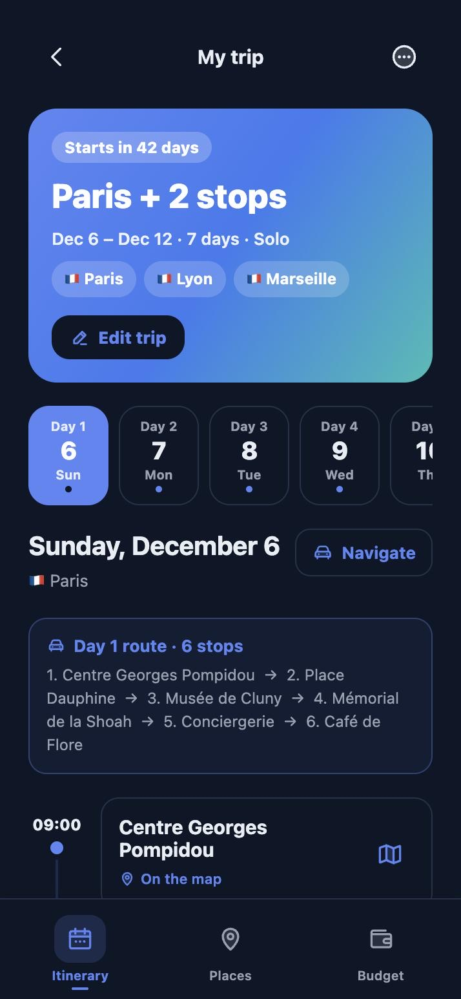
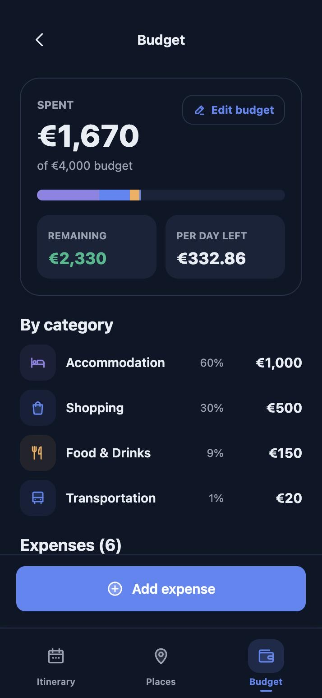
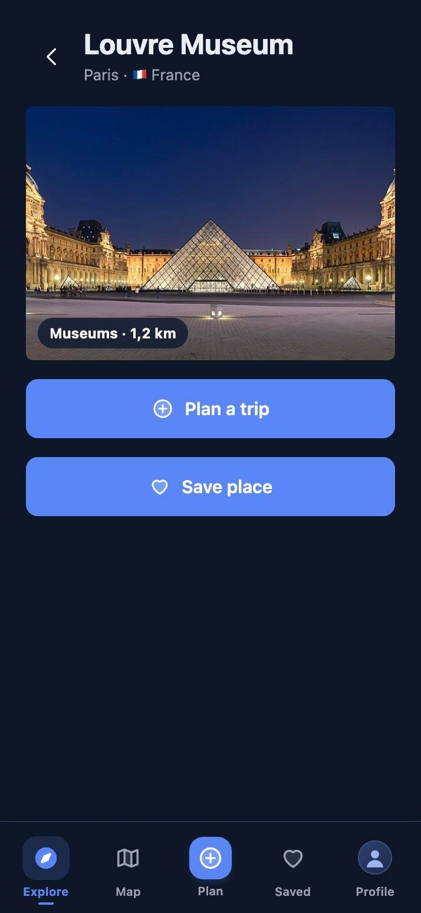

<p align="center">
  
</p>

<h1 align="center">GoWorth website</h1>

<p align="center">
  The presentation site for <a href="https://github.com/a-ndrewi/GoWorth">GoWorth</a>, the travel planner for iPhone and Android.
</p>

<p align="center">
  <a href="https://a-ndrewi.github.io/goworth-website/"><b>Open the site</b></a> ·
  <a href="https://github.com/a-ndrewi/GoWorth">App source</a>
</p>

<p align="center">
  
  
  
  
  
</p>

---

A single landing page in English and Romanian: app captures, a feature tour, the two product videos, plans and FAQ, App Store and Google Play buttons and a "Scan to download" QR code. It also serves the app's legal texts and the page that GoWorth's sign-up and password-reset emails open.

## Built with

React 19, Vite, Tailwind CSS 4, Motion, lucide-react and qrcode.react. TypeScript throughout, linted with oxlint.

## Run it

```bash
npm install
npm run dev
```

Checks:

```bash
npm run lint
npm run build
```

## Layout

```
src/
├── App.tsx          page and hash routes (#/legal/…)
├── config.ts        store and site links
├── i18n.tsx         all copy, English and Romanian
├── sections/        Hero, FeatureTour, Bento, Videos, Plans, Wheel, Faq, FinalCta, Footer…
├── components/      phone frame, store buttons, shared UI
└── legal/           privacy, terms, subscriptions, credits (copied from the app)
public/
├── auth/            email link bridge page (plain HTML)
├── screens/         app captures, dark theme
├── video/           the two vertical product ads, 720×1280
├── photos/          destination photos, CC0, sources in provenance.json
└── brand/           app icon
```

## Email links

`public/auth/index.html` is where sign-up and password-reset emails land after Supabase confirms the address. It opens the app with the link's one-time code (`goworth://auth?code=…`); on a computer it asks you to continue on your phone. It is plain HTML outside the React app, so it keeps working whatever happens to the landing page.

Its address must stay in the Supabase Auth redirect allow-list and in the app's `EXPO_PUBLIC_AUTH_LINK_URL`.

## Legal pages

`src/legal/legal.ts` and `legal-ro.ts` are copies of the app's `goworth/src/data/legal.ts` and `legal-ro.ts`. Copy them again whenever the app's legal texts change. They open at `#/legal/privacy`, `#/legal/terms`, `#/legal/subscriptions` and `#/legal/credits`.

## Before launch

- Set the real App Store URL in [`src/config.ts`](src/config.ts). The Google Play URL already uses the app's package, `com.andrewi.goworth`.
- `links.site` is encoded in the QR code. Point it at the production domain once there is one, and update the Supabase redirect allow-list and `EXPO_PUBLIC_AUTH_LINK_URL` to match.

## Deploy

Pushes to `main` build and deploy to GitHub Pages through [`.github/workflows/deploy.yml`](.github/workflows/deploy.yml) (enable it once under **Settings → Pages → Source: GitHub Actions**). The build uses a relative base path, so it also works on Vercel, Netlify or Cloudflare Pages with `npm run build` and `dist` as the output directory.

## Credits

Destination photos are from Wikimedia Commons under CC0; creators and source pages are listed in `public/photos/provenance.json`.

## License

Copyright © 2026 GoWorth. All rights reserved.
